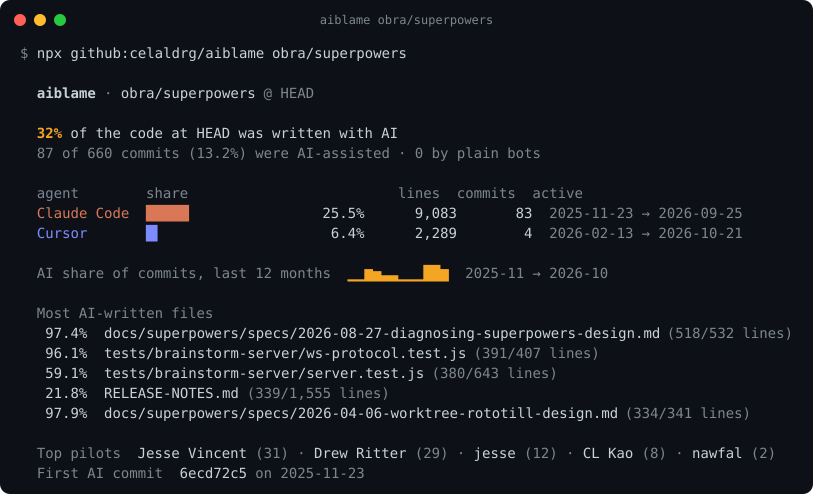
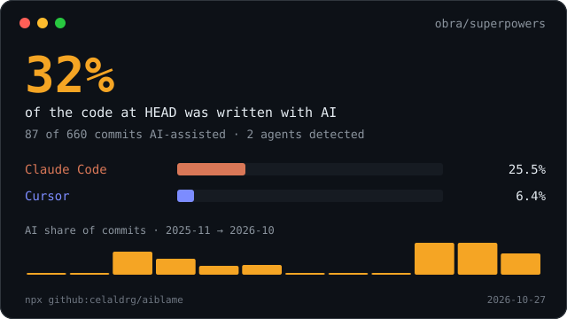

<div align="center">

# aiblame

**How much of this repo did AI write?**

`git blame` for the agent era. One command tells you what share of the code that is in your repo *right now*
was written by Claude Code, Cursor, Copilot, Codex, Aider, Devin, Jules, Gemini and friends.

[](https://github.com/celaldrg/aiblame/actions/workflows/ci.yml)
[](https://github.com/celaldrg/aiblame/releases)
[](LICENSE)




</div>

## Try it in 10 seconds

```sh
# in any git repo
npx -y github:celaldrg/aiblame

# or point it at any public GitHub repo
npx -y github:celaldrg/aiblame vercel/next.js
```

No install, no API key, no network calls except `git clone` for remote repos. Needs Node 20+ and git.

## What you get

- **The real number.** Not "how many commits mention Claude", but how many **lines at HEAD** were last touched by an AI-assisted commit (`git blame` over every file, in parallel).
- **Per-agent breakdown**: share, surviving lines, commits and the date range each agent was active.
- **Trend line**: AI share of commits over the last 12 months, as a sparkline.
- **Most AI-written files** and the **top pilots** (the humans who drove the agents).
- **A shareable card and a badge** (SVG) for your README, plus `--json` and `--markdown` for scripts and PR comments.
- **A CI policy gate**: `--fail-above 50` exits non-zero when a repo goes over your limit.
- **Honest by design**: it only counts agents that *sign their work*. No "AI detector" guesswork from code style.



## We ran it on trending repos

Numbers from `aiblame <repo>` on 2026-10-27 (share of current code written in AI-assisted commits):

| Repository | AI-written code | AI-assisted commits | Agents seen |
|---|---:|---:|---|
| [dyoshikawa/rulesync](https://github.com/dyoshikawa/rulesync) | **74.5%** | 3,574 / 5,591 | Claude Code, Cursor, Copilot, Devin |
| [max-sixty/worktrunk](https://github.com/max-sixty/worktrunk) | **64.8%** | 2,744 / 5,447 | Claude Code, Cursor, Codex |
| [obra/superpowers](https://github.com/obra/superpowers) | **32%** | 87 / 660 | Claude Code, Cursor |
| [anthropics/sandbox-runtime](https://github.com/anthropics/sandbox-runtime) | **15.3%** | 75 / 667 | Claude Code |
| [google-gemini/gemini-cli](https://github.com/google-gemini/gemini-cli) | **5.8%** | 272 / 6,536 | Gemini, Jules, Copilot |
| [openai/codex](https://github.com/openai/codex) | **4.1%** | 364 / 12,730 | Codex, Claude Code, Copilot |
| [charmbracelet/crush](https://github.com/charmbracelet/crush) | **2.2%** | 27 / 4,041 | Claude Code, Copilot, opencode |
| [astral-sh/ruff](https://github.com/astral-sh/ruff) | **0.9%** | 79 / 17,813 | Claude Code, Codex, Copilot |

These are **lower bounds**: an agent that doesn't add a trailer is invisible to aiblame (see [How it works](#how-it-works)).
Big repos were capped at the 2,000 largest files with `--max-files 2000`.

## Usage

```text
aiblame [path | owner/repo | git-url] [options]

  --fast              skip git blame; report share of added lines instead of surviving lines
  --since <date>      only commits after a date ("2025-01-01", "6 months ago"); implies --fast
  --rev <rev>         branch, tag or commit to analyse (default: HEAD)
  --max-files <n>     blame at most n files, largest first (default: 3000)
  --json              print the full report as JSON
  --markdown          print a Markdown summary (PR comments, job summaries)
  --card <file.svg>   write a shareable SVG report card
  --badge <file.svg>  write a shields-style badge
  --badge-label <s>   badge label (default: "AI-written")
  --fail-above <pct>  exit 1 if the headline percentage is above pct (CI policy gate)
  --no-color          disable colors (also respects NO_COLOR)
```

### Put a badge in your README

```sh
npx -y github:celaldrg/aiblame --badge docs/ai-badge.svg --card docs/ai-card.svg
```

```md

```


### GitHub Action

Writes a Markdown report to the job summary, and optionally a badge and card you can commit or upload.

```yaml
- uses: actions/checkout@v7
  with:
    fetch-depth: 0          # aiblame needs full history
- uses: celaldrg/aiblame@v0.1.0
  with:
    badge: ai-badge.svg
    card: ai-card.svg
    fail-above: ""          # e.g. "80" to fail the job above 80%
```

### As a library

```ts
import { readLog, blameLines, buildReport } from "aiblame";

const commits = await readLog(".");
const report = buildReport("my-repo", "HEAD", commits, await blameLines(".", "HEAD"));
console.log(report.headline); // { percent: 42.1, basis: "surviving-lines" }
```

## How it works

1. `git log --numstat` reads every commit once.
2. Each commit is classified by **self-declared signals only**:
   - co-author trailers, e.g. `Co-Authored-By: Claude <noreply@anthropic.com>`, `Co-authored-by: Cursor Agent <cursoragent@cursor.com>`, `aider (…) <noreply@aider.chat>`
   - agent bot accounts, e.g. `copilot-swe-agent[bot]`, `chatgpt-codex-connector[bot]`, `devin-ai-integration[bot]`, `google-labs-jules[bot]`
   - footers the tool writes itself, e.g. `🤖 Generated with Claude Code`, `aider: ` message prefix
3. `git blame --porcelain` runs over every text file at HEAD (8 in parallel) and counts the surviving lines that belong to each commit.
4. Plain automation (`dependabot`, `renovate`, `github-actions`…) is reported separately and **never** counted as AI.
5. Noise is excluded: lockfiles, `node_modules/`, `vendor/`, `dist/`, minified files, `*.gen.*`, files over 20k lines, and anything marked `linguist-generated` or `linguist-vendored` in `.gitattributes`.

A commit signed by several agents is credited to the first signature (author, then the first trailer), so the per-agent shares add up to the headline.

**Supported agents (v0.1.0):** Claude Code · Cursor · GitHub Copilot · OpenAI Codex · Aider · Devin · Google Jules · Gemini · Amp · opencode · Factory Droid · Windsurf · JetBrains Junie · Lovable · v0 · Cline · Roo Code.
Patterns are strict on purpose: they never match humans called Claude, Devin or Jules (there are tests for that).

### Limits, honestly

- Agents that don't sign commits (tab-completion, copy-paste from a chat window, agents with trailers turned off) are counted as human. Treat the number as a floor.
- A line edited by AI after a human wrote it counts as AI, the same way `git blame` gives it to the last author.
- Squash merges keep trailers only if your platform keeps them in the squashed message (GitHub does by default).

## Why not just grep?

| | `git log --grep Claude \| wc -l` | **aiblame** |
|---|:---:|:---:|
| Counts AI-assisted commits | ✅ (one agent at a time) | ✅ all agents at once |
| Lines that **survive at HEAD** (`git blame`) | ❌ | ✅ |
| Bot-account agents (Copilot coding agent, Codex, Devin, Jules) | ❌ | ✅ |
| Never flags humans named Claude / Devin / Jules | ❌ | ✅ (tested) |
| Ignores lockfiles, vendored and generated code | ❌ | ✅ |
| Any public repo in one command | ❌ | ✅ |
| SVG card, badge, Markdown, JSON | ❌ | ✅ |
| CI gate (`--fail-above`) and GitHub Action | ❌ | ✅ |

Other projects count AI trailers too, for example [vibe-coded-badge-action](https://github.com/ai-ecoverse/vibe-coded-badge-action), which turns the share of AI commits into a badge. aiblame's focus is the blame-based "how much of today's code" number, strict agent fingerprints and a CLI that works on any repo.

Inspired by `git blame`, `git-fame` and `git-quick-stats`. All code here is original.

## Roadmap

- [ ] More agents: Cline, Roo Code, Kiro, Qwen Code, Grok (PRs welcome, see [CONTRIBUTING](CONTRIBUTING.md))
- [ ] `--by-dir` breakdown (which parts of the codebase are AI-heavy)
- [ ] `--html` single-file interactive report
- [ ] Per-author view: how much each human ships with AI vs. alone
- [ ] Cache blame results between runs for huge monorepos
- [ ] Publish to npm (`npx aiblame`)

## Contributing

New agent signatures are the easiest way to help: one regex and two test cases.
Read [CONTRIBUTING.md](CONTRIBUTING.md) and pick a [good first issue](https://github.com/celaldrg/aiblame/labels/good%20first%20issue).

## License

[MIT](LICENSE) © Celalettin Durğaç
